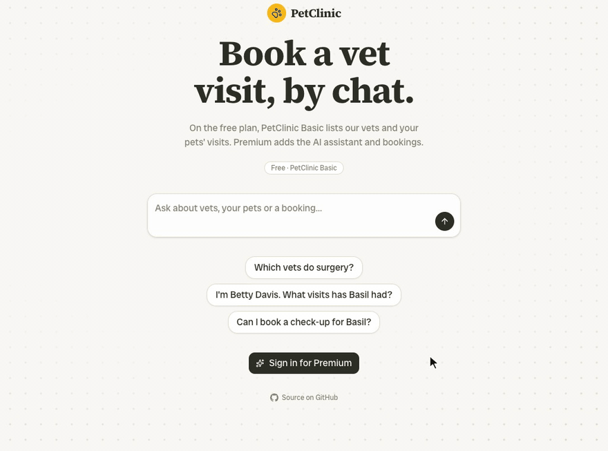

#  petclinic-agent

[](LICENSE)

A booking assistant for the [Spring PetClinic](https://github.com/spring-petclinic/spring-petclinic-rest) sample app, built to show how one request is traced across Vercel and a backend that runs somewhere else.



- **On Vercel:** an [eve](https://eve.dev) agent that finds owners, lists vets and books visits by calling the PetClinic REST API, plus a Next.js chat page (generated by `eve add channel/web`) with chat history, Speed Insights and Web Analytics. Two plans:
  - **Free** (no sign-in): *PetClinic Basic*, a rule-based model (`agent/lib/basic-model.ts`) that implements the AI SDK model interface. It makes real tool calls to list vets and look up owners, and never books. No model cost.
  - **Premium** (Sign in with Vercel): an AI Gateway model (`EVE_MODEL`, default Claude Haiku 5.5) with bookings, and a triage subagent that rates symptoms before a booking. If the model's providers fail, the AI Gateway falls back to `EVE_FALLBACK_MODEL` from another provider. After each booking, the chat app writes a visit note with the AI SDK.
- **On Vercel, in the background:** a clinic ops agent on [durable-harness](https://vercel.com/docs/agent-harnesses) (Pi's agent loop on a Workflow World). Once an hour it reads the next day's visits from PetClinic and posts a schedule. Its sessions appear in Agent Runs and, through `spanProcessors`, in the OTLP backend.
- **Outside Vercel, on any Docker host:** PetClinic, unchanged, with Postgres and the [OpenTelemetry Java agent](https://opentelemetry.io/docs/zero-code/java/agent/), behind Caddy. An [OpenTelemetry Collector](https://opentelemetry.io/docs/collector/) adds Caddy's access logs, Postgres slow-query logs and host metrics, and is the stack's only exit to the backend.
- **In any OTLP backend:** traces from both sides, joined into one trace by the W3C `traceparent` header the agent sends with every call. Both sides use the standard `OTEL_EXPORTER_OTLP_*` variables.

A community project from Bronto; not an official product of, or endorsed by, the integrated services.

## How it works

```
Browser / HTTP ──▶ eve agent (Vercel) ──traceparent──▶ PetClinic (your host) ──▶ Postgres
                         │                                   │
                         └── OTLP traces ──▶ OTLP backend ◀── OTLP traces, metrics, logs
```

One agent turn in the backend:

```
invoke_agent petclinic-agent                          petclinic-agent
├─ chat anthropic/claude-haiku-5.5                    petclinic-agent
├─ execute_tool find_owner                            petclinic-agent
│  └─ GET /petclinic/api/owners                       petclinic
│     └─ SpringDataOwnerRepository.findByLastName     petclinic
│        └─ SELECT petclinic.owners …                 petclinic
└─ chat anthropic/claude-haiku-5.5                    petclinic-agent
```

Vercel's own views (Observability, Agent Runs) show the agent side only. Vercel has no way to take in telemetry from services that run elsewhere.

## Repository layout

| Path | What it is |
| --- | --- |
| `agent/` | The eve agent: instructions, four tools, OpenTelemetry in `agent/instrumentation/` (the undici instrumentation for `fetch`, the standard OTLP exporter, and the plan and caller on each model call as `ai.settings.context.*`) |
| `apps/web/` | Next.js chat page; deployed as a second Vercel service next to the agent (`vercel.ts`) |
| `agent/subagents/triage/` | A declared eve subagent with its own instructions and no tools, on the Premium plan only; it runs as a child session with its own `invoke_agent` span |
| `agent/lib/models.ts` | The Premium model, its AI Gateway fallback and the `CHAOS_MODEL_OUTAGE` switch, shared by the agent and the subagent |
| `agent/lib/petclinic.ts` | PetClinic client, plain `fetch()`; the undici instrumentation adds the client span and `traceparent` |
| `petclinic/` | Docker Compose stack: PetClinic + Java agent, Postgres, Caddy (HTTPS, shared-key check, tracing), OpenTelemetry Collector (`otel-collector.yaml`) |
| `petclinic/browser/` | Synthetic visitor on the PetClinic host (Playwright): opens the chat page every ~5 minutes as a free-plan user, tagged `utm_source=synthetic`, for Web Analytics and Speed Insights |
| `apps/web/instrumentation.ts` | `@vercel/otel` for the Next.js app; `propagateContextUrls` carries the trace into PetClinic |
| `apps/web/app/vets/` | An ISR page (revalidate 60 s) that fetches PetClinic; `/clinic` redirects to it, `/petclinic-openapi.yml` is an external rewrite |
| `apps/web/app/api/visit-note/` | The visit note after a booking: AI SDK structured output through the AI Gateway, called by `book_visit` with the deployment's OIDC token; traced with `@ai-sdk/otel`, including the gateway's cost |
| `apps/web/lib/ops-agent.ts` | The ops agent: `pi()` from `durable-harness/pi` with two PetClinic tools, `visits_on` (replay `safe`) and `post_schedule` (replay `never`) |
| `apps/web/agent-runs.ts` | `agentRuns()` for the ops agent's traces, with a `SimpleSpanProcessor` to the OTLP backend; registered in `instrumentation.ts` |
| `apps/web/app/api/ops/` | Hourly cron: starts one ops session; `withDurableHarness` (`next.config.ts`) adds the queue route that runs its turns |
| `apps/web/app/api/chaos/` | Deliberate errors and crashes (`?kind=error`, `?kind=crash`), protected by `CHAOS_SECRET` |
| `apps/web/app/api/vercel-webhook/` | Forwards Vercel deployment webhooks as OpenTelemetry events (deploy markers), with the OpenTelemetry Logs SDK |
| `scripts/patch-eve-vercel-output.mjs` | Sets the region and the server function's `maxDuration` in eve's Build Output |
| `apps/web/app/api/synthetic/` | Synthetic traffic on Vercel (cron, every minute): Premium conversations, page loads, PetClinic calls, scanner probes |
| `petclinic/compose.public.yaml` | Additions for a public host: HTTPS on ports 80/443, the synthetic browser |
| `infra/deploy-lightsail.sh` | One hosting option: creates an AWS Lightsail instance and starts the stack |

## Run locally

Requires Node.js 24, pnpm and Docker.

```bash
cp petclinic/.env.example petclinic/.env     # set your OTLP endpoint, or OTEL_SDK_DISABLED=true
docker compose -f petclinic/compose.yaml up -d --build

pnpm install
vercel link && vercel env pull .env.local   # AI Gateway access via OIDC
cat >> .env.local <<ENV
PETCLINIC_URL=http://localhost:8088/petclinic/api
PETCLINIC_API_KEY=<same as petclinic/.env>
OTEL_EXPORTER_OTLP_ENDPOINT=<your OTLP/HTTP endpoint>
OTEL_EXPORTER_OTLP_HEADERS=<auth header, if needed>
ENV
pnpm dev          # agent with the eve terminal UI
pnpm dev:web      # chat page on http://localhost:3000 (sends to the agent on Vercel routes)
```

Try: "Hi, I'm Betty Davis. Please book a check-up for my hamster Basil next Tuesday."

## Deploy

### 1. PetClinic, outside Vercel

PetClinic needs a host that Vercel's functions can reach over HTTPS: any Linux VM or server with Docker and a public hostname (for example EC2, Lightsail, Hetzner, DigitalOcean or a machine of your own). Caddy gets a certificate for the hostname automatically, so ports 80 and 443 must be open and the hostname must point at the host.

```bash
git clone https://github.com/bronto-community/petclinic-agent.git
cd petclinic-agent/petclinic
cp .env.example .env   # set SITE_ADDRESS (your hostname), PETCLINIC_API_KEY,
                       # OTEL_EXPORTER_OTLP_ENDPOINT and OTLP_HEADERS
docker compose -f compose.yaml -f compose.public.yaml up -d --build
```

The agent then uses `PETCLINIC_URL=https://<your hostname>/petclinic/api`.

Options:

- **AWS Lightsail in one command:** `OTEL_EXPORTER_OTLP_ENDPOINT=... OTLP_HEADERS='{...}' ./infra/deploy-lightsail.sh` creates a 2 GB instance with a static IP and an `sslip.io` hostname, and prints `PETCLINIC_URL` and `PETCLINIC_API_KEY`.
- **For a quick test without a server:** run the stack locally (see above) and expose port 8088 with a tunnel such as `cloudflared` or `ngrok`.
- **Without the extras:** `compose.public.yaml` also starts the synthetic browser. Leave them out with `docker compose ... up -d postgres petclinic caddy otel-collector`.

### 2. Agent and chat page, on Vercel

Set `PETCLINIC_URL`, `PETCLINIC_API_KEY`, `OTEL_EXPORTER_OTLP_ENDPOINT` and `OTEL_EXPORTER_OTLP_HEADERS` as project environment variables, and `FUNCTION_REGION` to the [Vercel region](https://vercel.com/docs/regions) closest to your PetClinic host (for example `dub1` for eu-west-1). Then `vercel deploy --prod`. With the project connected to this repository, every push to `main` deploys to production, and the deployment webhook (`/api/vercel-webhook`, secret in `VERCEL_WEBHOOK_SECRET`) forwards each deploy with its commit as an OTLP log record.

## Configuration

| Variable | Where | Purpose |
| --- | --- | --- |
| `PETCLINIC_URL` | agent | PetClinic API base URL, ending in `/petclinic/api` |
| `PETCLINIC_API_KEY` | agent, petclinic | Shared key, sent as `X-PetClinic-Key` and checked by Caddy |
| `OTEL_EXPORTER_OTLP_ENDPOINT` | agent, web, petclinic | OTLP/HTTP base URL; `/v1/traces`, `/v1/metrics` and `/v1/logs` are appended. Without it, the agent exports nothing |
| `OTEL_EXPORTER_OTLP_HEADERS` | agent, web | Auth headers as `key=value,key2=value2` (values URL-encoded) |
| `OTLP_HEADERS` | petclinic | The same headers for the Collector, as a YAML map, e.g. `{authorization: "Bearer abc"}` (values as written) |
| `FUNCTION_REGION` | agent (build) | Vercel region for all functions, e.g. `dub1`. Pick the one closest to PetClinic: a call across the Atlantic added about 290 ms in the lab. Unset = Vercel's default |
| `EVE_MODEL` | agent | AI Gateway model ID for the Premium plan, default `anthropic/claude-haiku-5.5` |
| `EVE_FALLBACK_MODEL` | agent | AI Gateway fallback for the Premium plan, from another provider, default `google/gemini-3.8-flash` |
| `CHAOS_MODEL_OUTAGE` | agent | `1` lets only the fallback model's provider serve, so every Premium call falls back, as in a provider outage. Off by default |
| `VISIT_NOTE_MODEL` | web | AI Gateway model ID for the visit note, default `anthropic/claude-haiku-5.5` |
| `OPS_MODEL` | web | AI Gateway model ID for the ops agent, default `anthropic/claude-haiku-5.5` |
| `CHAOS_OPS_CRASH` | web | `1` arms a crash 50 ms into each ops session's first tool call: the function dies, and another resumes the turn from the session's log. Off by default |
| `WEB_URL` | agent (local) | Chat app URL for the visit note when not running on Vercel, default `http://localhost:3000` |

### Example backends

Any backend that accepts OTLP over HTTP works. For example:

| Backend | `OTEL_EXPORTER_OTLP_ENDPOINT` | `OTEL_EXPORTER_OTLP_HEADERS` (agent) | `OTLP_HEADERS` (petclinic) |
| --- | --- | --- | --- |
| Local [Jaeger](https://www.jaegertracing.io/) | `http://localhost:4318` | (none) | `{}` |
| [Bronto](https://bronto.io) | `https://ingestion.eu.bronto.io` (or `.us.`) | `x-bronto-api-key=<API key, URL-encoded>` | `{x-bronto-api-key: "<API key>"}` |

## License

[Apache-2.0](LICENSE)
